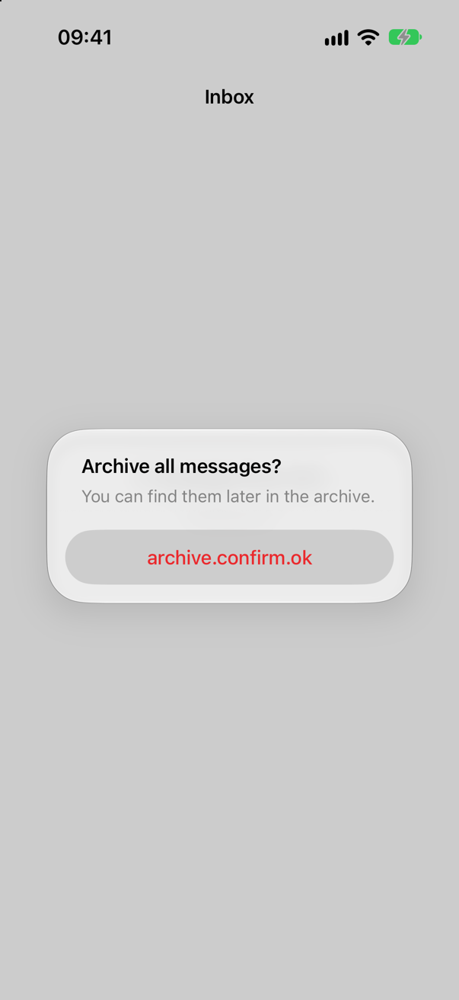
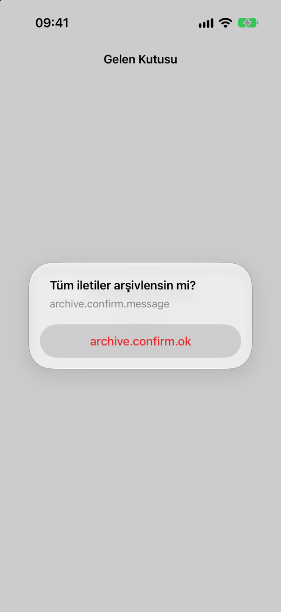

<!-- i18n-source: README.md@c32cc2ce311b4ffeda8e8efb2155f9b2654cfba5 status=reviewed -->
<!-- brand:start -->

<p align="center"><picture><source media="(prefers-color-scheme: dark)" srcset="https://raw.githubusercontent.com/muhittincamdali/GlobalLingo/master/.github/brand/banner-dark.svg"><source media="(prefers-color-scheme: light)" srcset="https://raw.githubusercontent.com/muhittincamdali/GlobalLingo/master/.github/brand/banner-light.svg"></picture></p>

<!-- lang-selector:start -->
<p align="center"><a href="README.md">English</a> · <a href="README.tr.md">Türkçe</a> · <a href="README.zh-CN.md">简体中文</a> · <a href="README.ja.md">日本語</a> · <a href="README.ko.md">한국어</a> · <a href="README.es.md">Español</a> · <a href="README.de.md">Deutsch</a> · <a href="README.fr.md">Français</a> · <a href="README.pt-BR.md">Português (Brasil)</a> · <a href="README.ru.md">Русский</a></p>
<!-- lang-selector:end -->

<p align="center">
<a href="https://github.com/muhittincamdali/GlobalLingo/actions/workflows/ci.yml"></a>
<a href="https://github.com/muhittincamdali/GlobalLingo/releases"><picture><source media="(prefers-color-scheme: dark)" srcset="https://raw.githubusercontent.com/muhittincamdali/GlobalLingo/master/.github/brand/badge-version-dark.svg"><source media="(prefers-color-scheme: light)" srcset="https://raw.githubusercontent.com/muhittincamdali/GlobalLingo/master/.github/brand/badge-version-light.svg"></picture></a>
<a href="https://github.com/muhittincamdali/GlobalLingo/blob/master/package.json"><picture><source media="(prefers-color-scheme: dark)" srcset="https://raw.githubusercontent.com/muhittincamdali/GlobalLingo/master/.github/brand/badge-language-dark.svg"><source media="(prefers-color-scheme: light)" srcset="https://raw.githubusercontent.com/muhittincamdali/GlobalLingo/master/.github/brand/badge-language-light.svg"></picture></a>
<a href="https://github.com/muhittincamdali/GlobalLingo/blob/master/LICENSE"><picture><source media="(prefers-color-scheme: dark)" srcset="https://raw.githubusercontent.com/muhittincamdali/GlobalLingo/master/.github/brand/badge-license-dark.svg"><source media="(prefers-color-scheme: light)" srcset="https://raw.githubusercontent.com/muhittincamdali/GlobalLingo/master/.github/brand/badge-license-light.svg"></picture></a>
</p>

<p align="center">
<a href="#schnellstart"><picture><source media="(prefers-color-scheme: dark)" srcset="https://raw.githubusercontent.com/muhittincamdali/GlobalLingo/master/.github/brand/button-start-de-dark.svg"><source media="(prefers-color-scheme: light)" srcset="https://raw.githubusercontent.com/muhittincamdali/GlobalLingo/master/.github/brand/button-start-de-light.svg"></picture></a>
<a href="https://muhittincamdali.github.io/GlobalLingo/"><picture><source media="(prefers-color-scheme: dark)" srcset="https://raw.githubusercontent.com/muhittincamdali/GlobalLingo/master/.github/brand/button-docs-de-dark.svg"><source media="(prefers-color-scheme: light)" srcset="https://raw.githubusercontent.com/muhittincamdali/GlobalLingo/master/.github/brand/button-docs-de-light.svg"></picture></a>
<a href="https://github.com/muhittincamdali/GlobalLingo/tree/master/docs/guides"><picture><source media="(prefers-color-scheme: dark)" srcset="https://raw.githubusercontent.com/muhittincamdali/GlobalLingo/master/.github/brand/button-guides-de-dark.svg"><source media="(prefers-color-scheme: light)" srcset="https://raw.githubusercontent.com/muhittincamdali/GlobalLingo/master/.github/brand/button-guides-de-light.svg"></picture></a>
<a href="https://github.com/muhittincamdali/GlobalLingo/tree/master/examples"><picture><source media="(prefers-color-scheme: dark)" srcset="https://raw.githubusercontent.com/muhittincamdali/GlobalLingo/master/.github/brand/button-examples-de-dark.svg"><source media="(prefers-color-scheme: light)" srcset="https://raw.githubusercontent.com/muhittincamdali/GlobalLingo/master/.github/brand/button-examples-de-light.svg"></picture></a>
</p>

> Dies ist eine Übersetzung der englischen README. Bei Abweichungen gilt die englische Fassung.

<!-- brand:end -->
GlobalLingo prüft die Lokalisierungsdateien einer iOS-, Flutter- oder React-Native/Expo-App, bevor sie ausgeliefert wird: Xcode String Catalogs, `.strings`- und `.stringsdict`-Dateien, Flutter-ARB-Dateien und JSON-Übersetzungsdateien. Es findet fehlende, leere und veraltete Übersetzungen, Platzhalter und Pluralformen, die zwischen den Sprachen nicht zusammenpassen, doppelte Schlüssel, Schlüssel, die der Code nachschlägt, die aber keine Datei definiert, fest im Code stehende UI-Texte und die Fallstricke des türkischen I mit und ohne Punkt – und nennt zu jedem Fund die Lösung. Es liest nur Dateien und braucht nichts außer Node.js.

<picture><source media="(prefers-color-scheme: dark)" srcset="docs/media/demo-flutter-dark.svg"><source media="(prefers-color-scheme: light)" srcset="docs/media/demo-flutter-light.svg"></picture>

<sub>Aufgenommen mit der echten CLI am <a href="fixtures/flutter-arb">Fixture flutter-arb</a>, einer Flutter-3.47.5-App (<code>npm run demo</code>). <code>flutter gen-l10n</code> akzeptiert die deutsche Datei und lässt danach den Build scheitern; siehe <a href="docs/guides/placeholders-and-plurals.md">die Anleitung</a>.</sub>

## Highlights

- **Vier Formate, ein Bericht.** String Catalogs, `.strings`/`.stringsdict`, ARB und JSON (i18next, i18n-js, react-intl/FormatJS) werden in dasselbe Modell eingelesen und mit denselben 19 Regeln geprüft. Ein Monorepo mit einer nativen App, einer Flutter-App und einer Expo-App erhält so einen einzigen Bericht.
- **Platzhalter so, wie jede Laufzeitumgebung sie liest.** Formatangaben werden nach Position und Typ geprüft (`%@` gegen `%lld`, `%d` gegen `%lld`, `%#@name@`-Ersetzungen), ICU- und i18next-Platzhalter nach Namen, jeweils pro Pluralform.
- **Pluralformen aus CLDR.** Jede Locale wird auf die Kategorien geprüft, die ihre Sprache verwendet (im Polnischen `few` und `many`, im Arabischen alle sechs), mit Beispielzahlen in der Meldung.
- **Auch der Code.** Schlüssel, die der Code nachschlägt, die aber kein Katalog definiert, Schlüssel, die kein Code erwähnt, SwiftUI-Literale, die im String Catalog fehlen, fest im Code stehender Text in UIKit, Flutter und React Native sowie Groß-/Kleinschreibungs-Umwandlungen, die auf türkischen und aserbaidschanischen Geräten fehlschlagen.
- **Für CI gemacht.** Exit-Codes 0/1/2, `--fail-on`, eine Baseline-Datei, damit nur neue Funde fehlschlagen, und Ausgabe als Text, Markdown, JSON, SARIF (Code Scanning) oder GitHub Annotations.
- **Auf jedem Repository begrenzt.** Keine Laufzeit-Abhängigkeiten, kein Netzwerk, symbolischen Links wird nicht gefolgt, Dateigröße, Tiefe und Anzahl der Funde sind begrenzt, und Text aus dem Projekt erreicht das Terminal nie mit Steuerzeichen.

## Schnellstart

Du brauchst [Node.js](https://nodejs.org/) 22.12 oder neuer (`node --version` zeigt die Version an; auf einem Mac installiert `brew install node` es). Sonst nichts: kein Xcode, keine Flutter- oder React-Native-Toolchain.

**1. Öffne ein Terminal im Ordner deiner App**, also dem mit der `.xcodeproj`, der `pubspec.yaml` oder der `package.json`:

```sh
cd path/to/YourApp
```

**2. Starte GlobalLingo:**

```sh
npx @mcamdali/globallingo
```

Das npm-Paket heißt `@mcamdali/globallingo`; der Befehl, den es installiert, ist `globallingo`.

**3. Lies die Funde.** Jeder nennt seine Regel, die Datei und Zeile, was falsch ist und wie es behoben wird, mit einem Link zur Dokumentation der Regel. Funde mit **ERROR** setzen den Exit-Code auf 1; die letzte Zeile zählt sie. Damit auch Warnungen fehlschlagen, füge `--fail-on warning` hinzu.

## Was GlobalLingo prüft

| Regel  | Schweregrad | Fund                                                                                           |
| ------ | ----------- | ---------------------------------------------------------------------------------------------- |
| MIS001 | error       | Eine Übersetzung fehlt (oder ein String-Catalog-Eintrag hat noch den Status "new")             |
| MIS002 | error       | Eine Übersetzung ist leer                                                                      |
| MIS003 | warning     | Eine String-Catalog-Übersetzung muss überprüft werden                                          |
| MIS004 | info        | Eine Übersetzung ist identisch mit dem Quelltext                                               |
| STA001 | warning     | Xcode markiert den Schlüssel als veraltet (stale)                                              |
| STA002 | warning     | Eine Übersetzung hat einen Schlüssel, den die Quellsprache nicht hat                           |
| FMT001 | error       | Ein Platzhalter, den die Quelle nicht hat, oder von einem anderen Typ                          |
| FMT002 | warning     | Ein Platzhalter der Quelle fehlt                                                               |
| FMT003 | error       | Eine Datei oder Nachricht lässt sich nicht parsen (JSON, `.strings`, plist, ICU, `%`-Sequenzen) |
| PLU001 | warning     | Eine Pluralform, die die Sprache braucht (CLDR), fehlt                                         |
| PLU002 | error       | Ein Plural hat keine `other`-Form                                                              |
| DUP001 | error       | Ein Schlüssel kommt in einer Datei zweimal vor                                                 |
| KEY001 | error       | Der Code schlägt einen Schlüssel nach, den kein Katalog definiert                              |
| KEY002 | warning     | Ein SwiftUI-Literal steht nicht im String Catalog                                              |
| KEY003 | info        | Keine Quelldatei erwähnt den Schlüssel                                                         |
| HCS001 | warning     | Text, der dem Nutzer angezeigt wird, steht fest im Code                                        |
| TRI001 | warning     | Die Groß-/Kleinschreibung eines Nachschlageschlüssels wird mit der Geräte-Locale geändert      |
| TRI002 | warning     | Ein Schlüssel enthält `İ` oder `ı`                                                             |
| TRI003 | warning     | Übersetzter Text wird ohne Locale in der Groß-/Kleinschreibung geändert, in einer App, die Türkisch oder Aserbaidschanisch ausliefert |

[docs/rules.md](docs/rules.md) beschreibt jede Regel mit Beispielen, der Lösung pro Ökosystem und den Dokumenten von Apple, Flutter, Unicode, ICU und der Bibliotheken, auf denen sie beruht.

## Installation

Führe es ohne Installation aus, wie oben, oder installiere den Befehl `globallingo`:

```sh
npm i -g @mcamdali/globallingo
globallingo
```

In einem JavaScript-Projekt legt `npm install --save-dev @mcamdali/globallingo` eine Version fest, und `npx globallingo` führt genau diese Kopie aus. Jedes [GitHub Release](https://github.com/muhittincamdali/GlobalLingo/releases) enthält das Paket außerdem als `globallingo-<version>.tgz` mit einer Datei `SHA256SUMS`, und der Release-Workflow öffnet eine Homebrew-Formula für `brew install muhittincamdali/tap/globallingo`.

Aus einem Klon:

```sh
git clone https://github.com/muhittincamdali/GlobalLingo.git
cd GlobalLingo && npm ci && npm run build
node dist/cli/main.js path/to/YourApp
```

## Verwendung

```text
globallingo [path] [options]
```

| Option                    | Was sie bewirkt                                                                    |
| ------------------------- | ---------------------------------------------------------------------------------- |
| `path`                    | Der Ordner der App; Standard ist der aktuelle Ordner                               |
| `-f, --format <format>`   | `tty` (Standard), `markdown`, `json`, `sarif` oder `github`                        |
| `-o, --output <file>`     | Schreibt den Bericht in eine Datei statt ins Terminal                              |
| `--fail-on <severity>`    | `error` (Standard), `warning`, `info` oder `none`: was den Exit-Code auf 1 setzt   |
| `-c, --config <file>`     | Einstellungsdatei; Standard ist `<path>/.globallingo.json`, falls vorhanden        |
| `--source <locale>`       | Die Quellsprache, wenn die Dateien sie nicht angeben                               |
| `--locales <list>`        | Prüft nur diese Locales, z. B. `de,tr,pl`                                          |
| `--baseline <file>`       | Funde in dieser Datei werden gemeldet, lassen den Lauf aber nicht fehlschlagen     |
| `--write-baseline <file>` | Schreibt alle Funde dieses Laufs in eine Baseline-Datei                            |
| `--no-code`               | Prüft nur die Lokalisierungsdateien, nicht den Quellcode                           |
| `--no-color`              | Reiner Text auch im Terminal (`NO_COLOR` und `FORCE_COLOR` werden beachtet)        |

Exit-Codes: `0` keine Funde auf der Stufe von `--fail-on` oder darüber, `1` Funde auf dieser Stufe oder darüber, `2` ungültige Argumente oder Einstellungen, keine Lokalisierungsdateien gefunden oder ein unerwarteter Fehler. Mit `--write-baseline` ist der Exit-Code `0`, sobald die Datei geschrieben ist. Ein Ordner ohne Lokalisierungsdateien ist ein Fehler, damit ein falscher Pfad in CI nicht stillschweigend durchläuft.

### In CI ausführen

[examples/github-actions/globallingo.yml](examples/github-actions/globallingo.yml) kommentiert den Pull Request, schreibt Abdeckung und Funde in die Job-Zusammenfassung, lädt SARIF für Code Scanning hoch und lässt den Job bei Fehlern fehlschlagen. [GlobalLingo in CI ausführen](docs/guides/ci.md) erklärt jeden Teil.

### Mit einer Baseline beginnen

```sh
npx @mcamdali/globallingo --write-baseline .globallingo-baseline.json
npx @mcamdali/globallingo --baseline .globallingo-baseline.json
```

Der erste Befehl akzeptiert die heutigen Funde; der zweite schlägt nur bei neuen fehl. Die Fingerabdrücke enthalten keine Zeilennummern, daher macht das Verschieben von Code die Datei nicht ungültig.

### Konfigurieren

Eine `.globallingo.json` im Ordner der App legt die Quellsprache, die erforderlichen Locales, ignorierte Pfade und Schlüssel sowie pro Regel einen Schweregrad (oder `off`) fest:

```json
{
  "locales": ["de", "pl", "tr"],
  "ignore": { "paths": ["**/__tests__/**"], "keys": ["legacy.*"] },
  "rules": { "HCS001": "error", "MIS004": "off" }
}
```

[docs/configuration.md](docs/configuration.md) listet jedes Feld auf, außerdem was GlobalLingo selbst findet und die Grenzen. Im Code wird eine Zeile, die auf `// globallingo-ignore` endet, nicht gemeldet.

### JSON-Bericht oder API verwenden

```sh
npx @mcamdali/globallingo --format json > globallingo.json
```

Der Bericht enthält die Kataloge mit der Abdeckung pro Locale sowie `rule`, `severity`, `file`, `line`, `key`, `locale`, `message`, `fix`, `docs` und `fingerprint` jedes Fundes (`schemaVersion` 1). [examples/shell/errors-by-locale.sh](examples/shell/errors-by-locale.sh) zählt die Fehler pro Locale mit `jq`. Dieselben Prüfungen laufen auch aus JavaScript:

```js
import { render, scan } from '@mcamdali/globallingo';

const report = await scan('path/to/app', { locales: ['de', 'tr'] });
console.log(report.summary);
console.log(render(report, 'markdown'));
```

[examples/api/coverage.mjs](examples/api/coverage.mjs) gibt die Abdeckung jedes Katalogs aus.

## Demo

Die Terminal-Aufnahmen stammen von der CLI auf den [Fixtures](fixtures/README.md), kleinen Apps, die mit der jeweiligen Toolchain gebaut wurden:

| Projekt                                                                 | Aufnahme                                                                               |
| ----------------------------------------------------------------------- | -------------------------------------------------------------------------------------- |
| Flutter-3.47.5-App mit ARB-Dateien                                      | oben auf dieser Seite                                                                  |
| Expo-SDK-58-App mit i18next                                             | [hell](docs/media/demo-expo-light.svg) · [dunkel](docs/media/demo-expo-dark.svg)       |
| SwiftUI-Paket, dessen String-Catalog-Schlüssel Xcode 27.1 extrahiert hat | [hell](docs/media/demo-swiftui-light.svg) · [dunkel](docs/media/demo-swiftui-dark.svg) |
| UIKit-App mit `.strings` und `.stringsdict` (XcodeGen)                  | [hell](docs/media/demo-uikit-light.svg) · [dunkel](docs/media/demo-uikit-dark.svg)     |

Gemessen am 28. Oktober 2026 auf einem Mac (Apple Silicon, M5 Max) mit Node.js 26.12, während andere Jobs die Load Average über 40 hielten: drei Serien mit je 100 Läufen von `node dist/cli/main.js` auf den vier Fixtures, einschließlich des Starts von Node.js. Die Mediane der drei Serien lagen bei 0.12, 0.13 und 0.14 Sekunden; der langsamste Lauf dauerte 0.54 Sekunden.

### Was Nutzer sehen

Das UIKit-Fixture im iOS-27.0-Simulator (iPhone 17, mit Xcode 27.1 gebaut), links Englisch und rechts Türkisch. Foundation zeigt den Schlüssel selbst an, wenn eine Übersetzung fehlt (`archive.confirm.message` auf Türkisch, MIS001) und wenn keine Tabelle den Schlüssel enthält (`archive.confirm.ok`, KEY001). `scripts/simulator-shots.sh` erstellt beide Screenshots.

<p align="center"> </p>

## Status

| Funktion                                                                                                                   | Status    |
| -------------------------------------------------------------------------------------------------------------------------- | --------- |
| String Catalogs, `.strings` (UTF-8, UTF-16, XML) und `.stringsdict`, ARB mit l10n.yaml, i18next, i18n-js und ICU-JSON       | funktioniert |
| 19 Regeln: Übersetzungen, veraltete und verwaiste Schlüssel, Platzhalter, Plurale, Duplikate, Schlüssel im Code, fest im Code stehender Text, türkisches I | funktioniert |
| Ausgabe als Terminal, Markdown, JSON, SARIF und GitHub Annotations; `--fail-on`; Baselines; `.globallingo.json`              | funktioniert |
| Programmatische API mit Typdeklarationen                                                                                   | funktioniert |
| YAML-Übersetzungsdateien (Rails-artiges i18n, i18next-YAML)                                                                | geplant   |
| `strings.xml` von Android für natives Android und die Android-Seite plattformübergreifender Apps                           | geplant   |
| Ein GitHub-Action-Wrapper (`uses: muhittincamdali/GlobalLingo@v2`) und Kommentare in Pull Requests                         | geplant   |
| Übersetzerkommentare: Schlüssel ohne Kommentar oder `@key`-Beschreibung melden                                             | geplant   |

## Grenzen

- **Muster, kein Compiler.** Die Code-Regeln lesen Swift, Objective-C, Dart und JavaScript/TypeScript mit geleerten Kommentaren und suchen nach den üblichen Wegen, auf denen jedes Ökosystem Text nachschlägt und anzeigt. Schlüssel, die erst zur Laufzeit gebildet werden, Wrapper um die Nachschlagefunktionen und Text, der über Variablen gesetzt wird, werden nicht erkannt.
- **Nur Literal-Schlüssel.** KEY001 prüft Schlüssel, die als Literale geschrieben sind. KEY003 zählt jedes Literal, jedes Präfix und jedes Dart-Member mit dem Namen des Schlüssels als Verwendung und meldet trotzdem einen Schlüssel, dessen Verwendung es nicht erkennen kann, weshalb es ein info-Fund ist.
- **SwiftUI-Interpolation.** Xcode macht aus `Text("\(count) books")` mithilfe der Typinformationen des Compilers den Schlüssel `%lld books`. GlobalLingo hat sie nicht, deshalb überspringt KEY002 Literale mit Interpolation oder `%`.
- **CLDR-Version.** Die Pluralkategorien stammen aus den CLDR-Daten des Node.js, das GlobalLingo ausführt (CLDR 49 in Node.js 26.12). Ein neueres CLDR kann einer Sprache eine Kategorie hinzufügen.
- **Nur Dateien.** GlobalLingo baut, startet oder ändert nichts; es schreibt nur den Bericht oder die Baseline, die du anforderst.

## Dokumentation

API-Referenz, Regeln, Konfiguration und Anleitungen: [muhittincamdali.github.io/GlobalLingo](https://muhittincamdali.github.io/GlobalLingo/).

## Anleitungen

- [GlobalLingo in CI ausführen](docs/guides/ci.md)
- [Platzhalter und Plurale bei Apple, Flutter und JavaScript](docs/guides/placeholders-and-plurals.md)
- [Das türkische I](docs/guides/turkish-i.md)
- Referenz: [Regeln](docs/rules.md) und [Konfiguration](docs/configuration.md)

## Verwandte Tools

Andere Projekte prüfen einige derselben Dateien; welches passt, hängt davon ab, was du einsetzt:

- [xcstrings-lint](https://github.com/thatswiftguy/xcstrings-lint) ist eine GitHub Action für String Catalogs und `.strings`-Dateien, mit einem Ratchet-Modus, der nur die Probleme blockiert, die ein Pull Request neu einführt, und einem Kommentar im Pull Request.
- [i18n-check](https://github.com/lingualdev/i18n-check) validiert JSON- und YAML-Übersetzungsdateien von JavaScript-Apps (ICU und i18next), einschließlich ungenutzter und nicht definierter Schlüssel über i18next-parser.
- [BartyCrouch](https://github.com/FlineDev/BartyCrouch) hält `.strings`-Dateien mit Swift-Code und Storyboards synchron, kann über eine API übersetzen und prüft auf doppelte Schlüssel und leere Werte.
- [StringsLint](https://github.com/dral3x/StringsLint) meldet fehlende und ungenutzte `.strings`-Schlüssel in Swift- und Objective-C-Projekten.
- Der String-Catalog-Editor von Xcode zeigt den Übersetzungsfortschritt jeder Sprache, und `gen-l10n` von Flutter listet nicht übersetzte Nachrichten mit `untranslated-messages-file` auf.

GlobalLingo liest alle vier Formate in einem Lauf und ergänzt Platzhaltertypen, CLDR-Pluralformen, die Code-Prüfungen und die Regeln zum türkischen I. Die obigen Beschreibungen stammen aus der README des jeweiligen Projekts vom 28. Oktober 2026.

## Voraussetzungen

| Toolchain | Mindestversion |
| --------- | -------------- |
| Node.js   | 22.12          |

GlobalLingo braucht weder Xcode noch Flutter oder React Native: Es liest Dateien und läuft daher auch unter Linux. CI führt die Tests mit Node.js 22 und 24 (Linux) aus; lokal bestehen alle 256 mit Node.js 22.23, 24.22 und 26.12 auf einem Mac (Apple Silicon).

## Architektur

```text
path ─► walk                 files of the folder (no symbolic links, no dependency folders, limits)
     ─► discoverCatalogs     String Catalogs, .lproj tables, ARB folders (l10n.yaml), JSON locale folders
          parse/             JSON, .strings, plist readers with line numbers and duplicate keys
          catalogs/          one model: catalog → key → translation per locale (texts, plurals, state)
     ─► checkCatalog         MIS, STA, FMT, PLU, DUP, TRI002 rules
          messages/          printf, ICU, i18next and i18n-js placeholder parsers; CLDR via Intl
     ─► checkSource          KEY001, KEY002, HCS001, TRI001, TRI003 on comment-blanked source code
     ─► unusedKeys           KEY003 from the literals and members of all source files
     ─► render               tty | markdown | json | sarif | github
```

- Jeder Fund besteht aus einer Regel-ID, einem Schweregrad (dem Standard der Regel oder dem aus der Konfiguration), einer Datei und Zeile, einer Meldung, der Lösung der Regel für das Ökosystem des Fundes, einem Link zur Dokumentation und einem Fingerabdruck für Baselines.
- Jeder Reader bricht bei einer Verschachtelungsgrenze ab und braucht Zeit im gleichen Maß wie seine Eingabe, sodass präparierte Dateien weder den Stack noch die Zeit erschöpfen können; die Tests füttern ihn mit JSON aus 100.000 Ebenen und messen, wie die Zeit für präparierte Kataloge, Einstellungen und Quelldateien von 128 KB bis 2 MB wächst.
- Die CLI (`src/cli/`) parst nur Argumente, wählt Farben und Breiten und setzt den Exit-Code.

## Roadmap

Siehe die Tabelle unter [Status](#status): YAML-Dateien, Android-`strings.xml`, ein GitHub-Action-Wrapper und Übersetzerkommentare sind geplant. [CHANGELOG.md](CHANGELOG.md) listet auf, was jedes Release geändert hat.

## FAQ

**Ändert GlobalLingo meine Dateien?** Nein. Es liest sie und schreibt nur den Bericht oder die Baseline, die du anforderst.

**Warum braucht Polnisch vier Formen, wenn Englisch zwei hat?** Polnisch verwendet eine Form für 1, eine andere für 2–4 (und 22–24, 32–34 …), eine weitere für 0 und 5–21 (und 25–31 …) und eine vierte für Brüche. CLDR hält diese Regeln pro Sprache fest; [die Plural-Anleitung](docs/guides/placeholders-and-plurals.md) enthält die Tabelle.

**Meine App hat keine türkische Übersetzung. Kann TRI001 trotzdem relevant sein?** Ja. Es geht um die Sprache des Geräts, nicht der App: Ein Schlüssel, der mit `toLocaleLowerCase()` in Kleinbuchstaben umgewandelt wird, macht auf jedem türkischen Gerät aus `I` ein `ı`. [Das türkische I](docs/guides/turkish-i.md) zeigt es.

**Ein Fund ist für mein Projekt falsch. Was tun?** Stufe die Regel in `.globallingo.json` herab oder schalte sie ab, ignoriere den Schlüssel oder Pfad oder markiere die Zeile mit `globallingo-ignore`, und eröffne bitte ein Issue mit dem kleinsten Beispiel, das ihn zeigt.

## Mitwirken

Beiträge sind willkommen: Lies [CONTRIBUTING.md](CONTRIBUTING.md) und den [Verhaltenskodex](https://github.com/muhittincamdali/.github/blob/main/CODE_OF_CONDUCT.md), bevor du einen Pull Request öffnest, und melde Sicherheitsprobleme wie in [SECURITY.md](SECURITY.md) beschrieben.

## Lizenz

Veröffentlicht unter der MIT-Lizenz. Siehe [LICENSE](LICENSE).
